# 🎯 Python Quiz Game

Python 기초 문법을 퀴즈 형식으로 학습하기 위해 제작한 콘솔 기반 프로그램입니다.

## 1. 프로젝트 개요

Python의 기본 문법을 문제 풀이 방식으로 학습할 수 있도록 개발했습니다.

객체 지향 프로그래밍, 파일 입출력, JSON 데이터 저장, Git 버전 관리 등을 직접 경험하는 것을 목표로 합니다.

## 2. 퀴즈 주제 선정 이유

Python을 처음 배우는 학습자가 자주 사용하는 문법과 개념을 반복적으로 학습할 수 있도록 Python 기초를 주제로 선정했습니다.

주요 주제:
- 변수와 자료형
- 문자열과 숫자
- 리스트와 딕셔너리
- 조건문
- 반복문
- 함수
- 클래스와 객체
- 파일 입출력
- JSON
- 예외 처리

## 3. 개발 환경

- OS: Windows 11 / WSL2 Ubuntu
- Language: Python 3.10+
- Editor: Visual Studio Code
- Version Control: Git / GitHub
- Storage: JSON
- External Libraries: None

## 4. 실행 방법

프로젝트 폴더로 이동합니다.

```bash
cd ~/projects/python-quiz-game

## 10. 실행 화면

스크린샷은 `docs/screenshots/` 폴더에 저장합니다.

### 개발 환경
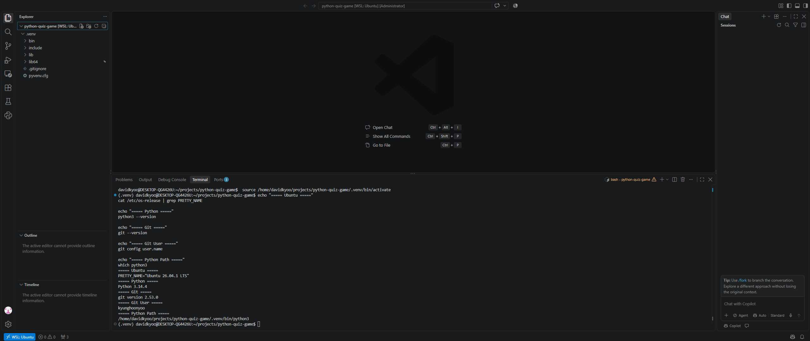

### 프로젝트 파일 구조
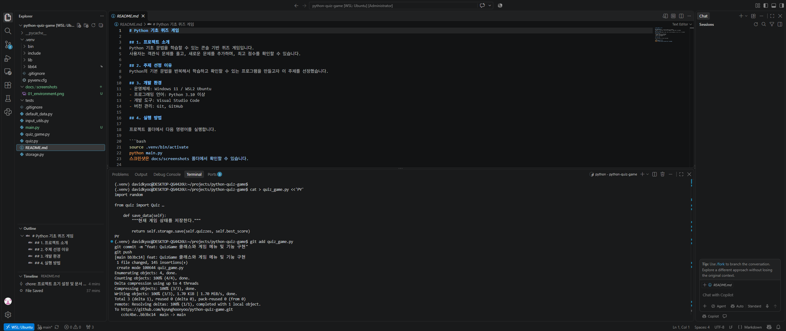

### 메인 메뉴
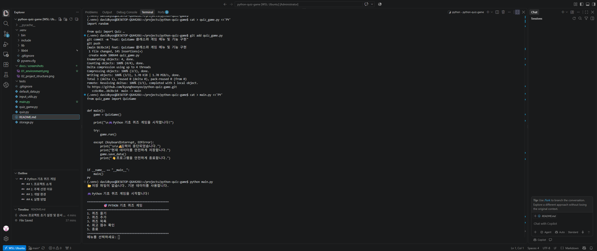

### 퀴즈 추가
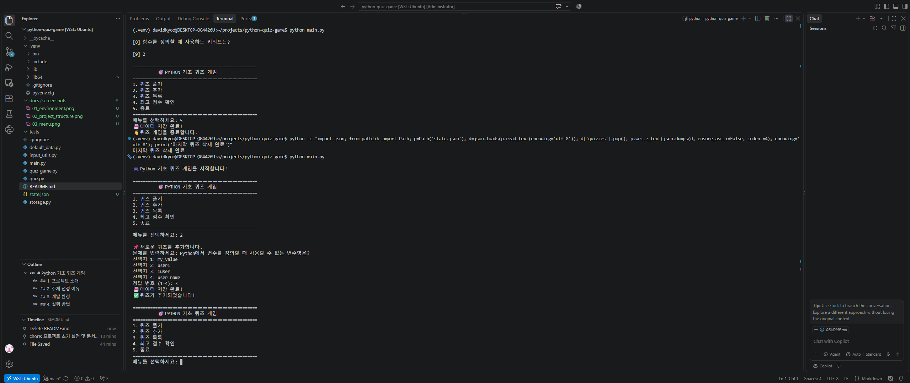

### 퀴즈 목록
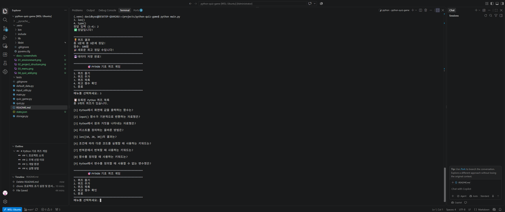

### 퀴즈 풀이
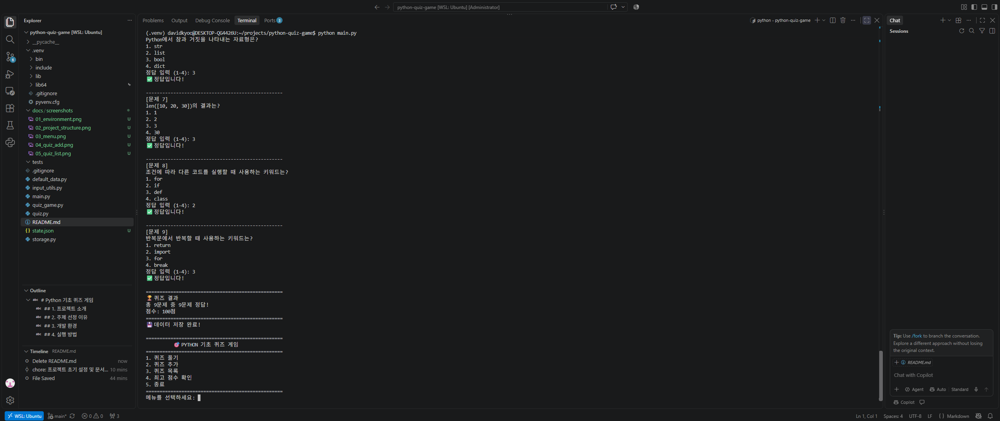

### 최고 점수
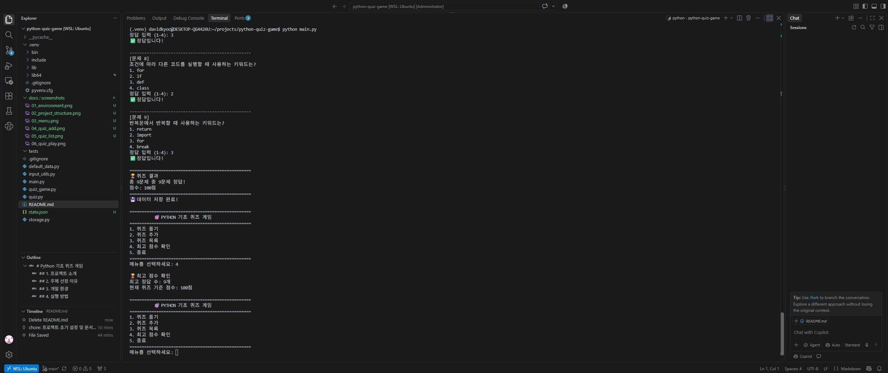

### 데이터 저장 및 불러오기
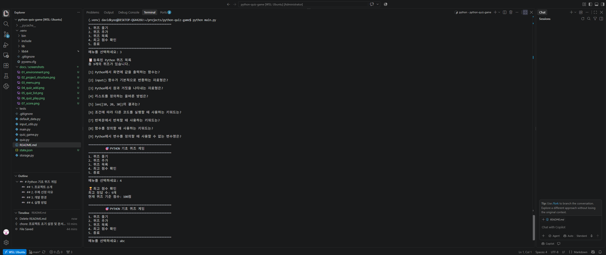

### 잘못된 입력 처리
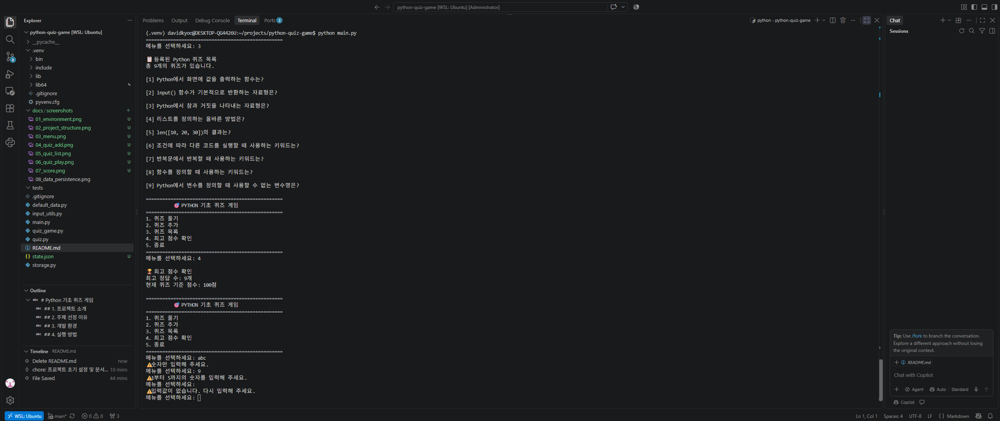

### Git 브랜치 병합
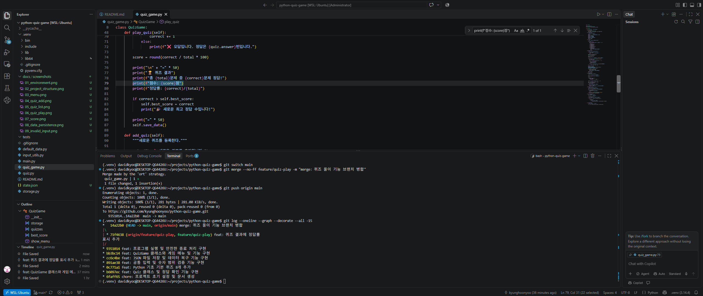

### Git Clone 및 Pull
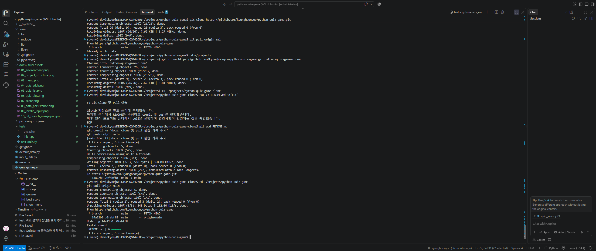

### 자동 테스트
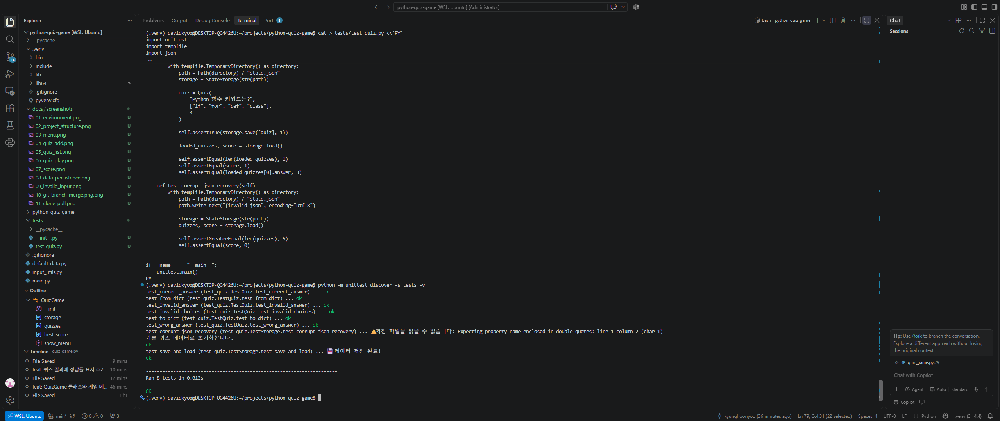

## Git Clone 및 Pull 실습

GitHub 저장소를 별도 폴더에 복제했습니다.
복제한 폴더에서 README를 수정하고 commit 및 push를 진행했습니다.
이후 원래 프로젝트 폴더에서 pull을 실행하여 변경사항이 반영되는 것을 확인했습니다.

## Git clone / pull 실습

별도 디렉터리에 저장소를 clone한 뒤 README를 수정하고 push했습니다.
기존 작업 디렉터리에서 pull을 수행하여 원격 변경사항이 반영되는 것을 확인했습니다.
